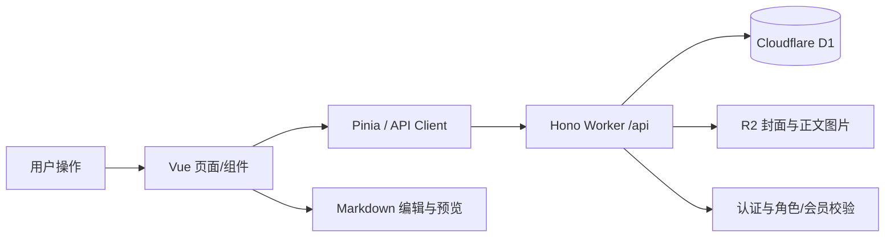

# 1. 项目是什么

项目名为“游浪游戏资源发布网站”（包名 `youlun-game-resource`），是面向 PC 游戏资源浏览与下载的响应式网站。用户可以搜索、分类/标签筛选游戏，注册登录后获取免费资源，会员可访问会员资源；还支持会员付款工单、问题反馈、密码修改和历史记录。管理员后台可维护游戏、下载链接、分类标签、用户权限、会员工单和反馈。当前前后端、D1 数据库、权限校验及桌面/手机版均已实现，采用单个 Cloudflare Worker 统一部署。

# 2. 技术栈

- Vue 3、TypeScript、Vite：前端 SPA 与构建。
- Vue Router、Pinia：路由权限和登录会话状态。
- Element Plus、Lucide Vue：表单、弹窗、分页和图标。
- Hono、Zod：Cloudflare Worker API、路由和输入校验。
- Cloudflare Workers、D1、Wrangler：运行时、SQLite 数据库、迁移和部署。
- Cloudflare R2：管理员通过 Worker 上传封面和正文图片，旧 Cloudinary 图片地址继续兼容；`markdown-it` + DOMPurify 渲染 Markdown 介绍。
- Playwright：Edge 桌面和手机视口端到端测试。

# 3. 核心目录

- `src/`：Vue 前端；`views/` 是页面，`components/` 是共享组件，`api/` 是请求层，`stores/` 是状态管理。
- `worker/src/`：Hono 后端、认证、管理员 API 和 Worker 类型。
- `worker/migrations/`：D1 数据库结构迁移；`worker/seeds/` 仅用于本地开发数据。
- `public/assets/`：品牌图、首页背景和付款码等静态资源。
- `tests/e2e/`：核心用户流程和响应式冒烟测试。

# 4. 核心文件

- `src/App.vue`：全站页面过渡；通过以 `route.path` 为键的单元素容器兼容多根节点页面，离场页面暂停交互，避免切换时叠高。
- `src/router/index.ts`：全部页面路由及登录/管理员守卫；公开页后台恢复会话，不等待会话接口；登录页和受保护页面仍等待身份确认；导出导航进度和失败提示状态。
- `src/api/client.ts`：前端所有 API 类型与调用入口；接口契约变化需同步修改。
- `src/stores/auth.ts`：会话恢复、登录、注册、退出及会员/管理员派生状态。
- `src/stores/theme.ts`：日间/夜间主题，默认跟随系统，手动选择以 `youlun-theme` 保存并同步其他标签页；`index.html` 的首屏脚本提前应用主题，避免夜间刷新闪白。
- `src/views/HomeView.vue`、`GamesView.vue`、`ProfileView.vue`：首页轮播、游戏分页筛选、个人中心与会员工单的主要实现。游戏库采用顶部横向筛选（发布年份、免费/会员、分类、标签多选），已选条件支持单项移除；样式位于 `src/styles/catalog.css`。
- `src/utils/catalogQuery.ts`、`catalogCache.ts`、`catalogNavigation.ts`：公开游戏库查询归一化、六页/120 条以内的 30 秒 LRU 缓存、最多 12 个列表滚动位置和内容渲染完成信号。缓存键含全部条件及每页数量；成功后台写操作清缓存，刷新强制重新获取，过期/失败/取消请求不写缓存。
- `src/views/GameDetailView.vue`：封面摘要、介绍、最低配置与下载卡片；封面不显示硬编码的平台标识；桌面下载区吸顶，手机按介绍、下载、配置排列；包含骨架屏、加载重试、封面回退和资源维护状态。
- `src/views/AdminView.vue`：独立侧栏、顶栏和主题切换的管理后台；“回到网站”位于顶部栏最右侧。概览展示真实统计与待办，游戏列表使用分类/权限/发布状态下拉筛选；分类与标签通过顶部两个按钮切换，每次进入该模块默认显示分类，单次只渲染一张表。
- `src/components/AdminUsers.vue`：用户管理角色标签及计数、用户名/账号/有效会员筛选、只读表格、右侧抽屉和当前页批量操作；每页 10 条服务端分页，筛选/翻页/刷新清空选择，请求支持取消、15 秒超时和旧响应隔离。
- `src/components/AdminGameEditor.vue`：游戏编辑弹窗的四个页签（基础信息、游戏介绍、配置要求、标签与下载）；`src/utils/adminGameForm.ts` 负责旧数据载入、配置序列化、跨页签校验和提交载荷；`src/styles/admin.css` 为后台独立样式。
- `src/composables/useAdminGames.ts`：后台列表请求取消、15 秒超时和过期响应隔离；组件内 LRU 最多缓存 6 页/60 条，30 秒过期，写入/删除/手动刷新使缓存失效，离开后台时释放。
- `src/styles.css`：基础样式、动画和响应式规则；`src/styles/theme.css`：夜间语义颜色、Element Plus 变量、导航提示及主题按钮的手机适配。
- `worker/src/index.ts`：公开 API、认证入口、反馈、会员工单、下载权限和全局中间件。
- `worker/src/admin.ts`：管理员专用 API；涉及后台 CRUD、审核或用户权限时优先查看。
- `worker/src/media.ts`：管理员图片上传、文件大小/签名校验及公开图片读取；`MEDIA` 为 R2 绑定，线上图片域名使用 `MEDIA_PUBLIC_URL`，本地使用 `/api/media/`。
- `src/components/MarkdownEditor.vue`、`MarkdownContent.vue`：介绍编辑、共享预览/详情渲染、图片上传与放大；`src/utils/markdown.ts` 处理安全渲染和旧文本转换，`imageUpload.ts` 处理浏览器压缩与上传，`src/styles/markdown.css` 适配手机和深色主题。
- 后台用户列表与登录、下载鉴权共用 `serializeUser` 判断会员有效性：到期月度会员返回 `none`，保留原数据库会员记录和到期时间；保存用户后刷新列表，展示当前有效身份。
- `worker/src/auth.ts`：PBKDF2 密码哈希、HttpOnly Cookie、会话读取与会员有效期计算。
- `wrangler.toml`：生产 Worker、静态资源、D1 绑定、允许来源和日志配置。

# 5. 数据 / API

业务数据存于 Cloudflare D1。完整表结构在 `worker/migrations/0001_initial.sql`，登录限流表在 `0002_auth_attempts.sql`；主要表包括用户、会话、游戏、下载链接、分类、标签、反馈和会员工单。API 均位于 `/api`，由 `worker/src/index.ts` 和 `admin.ts` 提供；管理员列表接口使用 `q` 参数搜索，提供游戏、工单、反馈和用户删除接口。前端通过 `src/api/client.ts` 使用 Cookie 同域通信。公开游戏接口不会返回真实下载 URL，下载地址只能通过鉴权接口取得。

重要配置包括 Worker 的 `DB`、`ASSETS`、`MEDIA`、`MEDIA_PUBLIC_URL`、`APP_ENV`、`ALLOWED_ORIGIN`，以及前端可选的 `VITE_API_BASE_URL`、`VITE_SUPPORT_EMAIL`。R2 桶为 `youlang`，图片域名为 `https://cdn.youlang.cc.cd`，Worker 使用绑定访问，无需 S3 密钥。不得在文档或代码中记录真实密钥。

`0003_game_description_format.sql` 新增 `games.description_format`（`plain` / `markdown`）。历史数据默认 `plain`，新后台创建默认 `markdown`，旧客户端更新省略格式时保留原值；正文仍存 `description`，上限 30000 字符。游戏列表只返回卡片字段（`GameSummary`），详情才返回正文和最低配置（`Game`）。`POST /api/admin/uploads/images` 接收 `file` 与 `purpose`，返回 `key/url`，仅管理员可调用；限制单张 5 MB、JPG/PNG/WebP。公开图片路由在会话中间件之前挂载，避免图片请求访问 D1。

`0004_user_management.sql` 新增 `users.is_super`、`last_login_at`、后台查询索引及超管身份保护触发器，一次性将已有未删除的 `s0xu` 初始化为启用的超级管理员；运行时只判断字段，迁移时不存在的账号需按 README 手动初始化。登录成功记录 `last_login_at`，历史账号没有登录记录时展示“暂无记录”，不推测旧时间。当前身份新增 `isSuper`。`GET /api/admin/users` 返回 `{ users, counts, pagination }`，支持 `q/role/status/memberType/page`；counts 应用搜索与账号/会员筛选，但不应用角色标签条件，三项计数覆盖全部符合条件账号而非当前页。`POST /api/admin/users/bulk` 支持 `disable/membership`，整批检查后使用 D1 事务 batch 写入；批量月度会员必须明确传入统一到期时间，会员变更继续写入审计记录。用户、工单、反馈均固定每页 10 条并回退越界页码，工单/反馈列表返回 `{ items, pagination }`。

# 6. 功能之间的关系



公开页面在后台恢复会话，登录页及受保护页面等待会话确认（请求超时 8 秒，网络失败可重试）；Worker 从 Cookie 查询会话并把用户放入请求上下文。游戏列表经 API 分页（桌面 20、手机 8，后端上限 20），越界页码自动回退至最后有效页。首页、顶部搜索栏与游戏库共用公开游戏列表接口，`q` 只匹配游戏名称，不搜索游戏介绍；支持叠加 `year`（当前发布日期的年份）、`resourceType`、分类及最多 20 个有效标签（交集匹配）。`/api/game-filters` 返回公开分类/标签和有已发布游戏的年份，不包含草稿年份。游戏库列表和筛选项请求支持取消及 15 秒超时，只接收当前请求结果；离开路由时清理搜索防抖和请求，导航失败时恢复加载。下载、反馈、工单要求登录，会员下载和 `/admin/*` 还会进行服务端权限校验。

# 7. 怎么运行

```bash
npm install
npm run db:migrate:local
npm run db:seed:local
npm run dev:api
npm run dev
```

API 默认是 `127.0.0.1:8787`，Vite 是 `127.0.0.1:5173`。检查与发布命令：

```bash
npm run typecheck
npm run typecheck:api
npm run test:e2e
npm run build
npm run db:migrate:remote
npm run deploy
```

# 8. 修改时注意什么

- 页面内容先改对应 `views/*.vue`；共享导航/卡片看 `components/`，全局和移动端表现看 `styles.css`。
- API 字段变化必须同步后端路由、`src/api/client.ts` 和使用该数据的页面；数据库变化必须新增迁移，不要直接改已执行的迁移。
- 不要把下载 URL 放入公开游戏响应，也不要只依赖前端判断会员或管理员权限。
- 用户管理禁止对超级管理员进行编辑/禁用/删除；普通管理员只能管理普通用户，任免其他管理员仅限超管，禁止删除/禁用/降级自己。单用户、批量及工单开通会员共用服务端保护规则；不要恢复用户名硬编码或允许客户端写入 `is_super`。禁用/删除撤销会话，月度有效性与鉴权一致，7 天内到期显示橙色。发布前执行 `0004` 迁移；不要重复执行生产 seed。
- 认证使用 PBKDF2、哈希会话令牌和 HttpOnly Cookie；当前迭代次数兼顾 Worker CPU 限制，不要随意提高或改成不兼容算法。
- 首页背景会随机开始、预加载后线性缩放并交叉淡入；修改时要保持无灰屏并兼容 `prefers-reduced-motion`。
- 页面过渡为短暂淡入和轻微位移，兼容 `prefers-reduced-motion`；仅路径变化重建页面，筛选和个人中心标签变化保持滚动位置。详情页在挂载时按当前 slug 加载，依赖 `App.vue` 的路径键，不能直接改回只按路由名称复用。
- 游戏库翻页使用 `router.push`，筛选使用 `router.replace`；详情卡片通过 history state 保存完整来源路径，返回链接需拆分 path/query，恢复条件、页码和滚动。列表内容及筛选就绪后才恢复滚动，避免慢请求下页面高度不足；快速导航撤销旧滚动等待。手机/桌面切换每页数量时回第一页并使用独立缓存键。
- 管理后台最低配置固定字段最终仍保存为 `minConfig: string[]`，不要误改为新数据库对象结构。
- 后台游戏编辑页签使用 `v-show` 保持输入和上传状态；提交时切换至第一个错误所在页签并聚焦字段。空白下载行不入库，填写部分内容时要求补全；标签最多 20 个，下载来源最多 20 行。封面支持拖拽和地址输入，保持已有 Cloudinary/R2 地址兼容。
- 后台 `/api/admin/games` 支持 `q`、`categoryId`、`resourceType`、`status`、`page` 的组合筛选；计数和列表必须共用条件，固定每页 10 条，越界页码回退至最后有效页，前端采用服务器返回的页码。筛选变更回第一页，禁止无限积累分页缓存。
- Markdown 关闭原始 HTML，并清理生成结果；预览和详情使用同一组件。旧纯文本不得未经转换直接按 Markdown 解释；转换与图片上传结果随保存游戏生效。上传进行中禁用保存，关闭编辑器取消上传。正文是公开内容，不能承载需要鉴权的下载地址。
- R2 图片使用随机对象 key 和长期缓存，旧图地址保留；暂不自动删除未引用图片，清理前检查封面、正文和草稿引用。生产发布新代码前须执行 `0003` 迁移；本地 R2 数据不会上传到线上。
- `wrangler.toml` 中 Worker 名称、D1 ID、资源绑定、生产来源和 SPA 静态资源策略相互关联，不要随意替换。生产库不要重复执行开发 seed。
- 修改后至少运行类型检查和构建；按用户最新偏好，非重要样式和交互修改无需默认运行端到端测试，由用户手动体验；重要业务或权限变更再选择必要测试。

# 9. 后续优化方向（2026-10-04 代码检查）

- 已处理游戏库旧响应覆盖、延迟搜索打断导航和会话恢复阻塞公开页面的问题；会话网络失败不再标记为初始化成功，过时恢复结果不会覆盖后续登录/退出状态。
- `src/main.ts` 全量导入 Element Plus CSS；本次构建入口样式约 403 kB（gzip 约 57 kB）。可评估按组件加载样式，并拆分全局文件中的页面专属样式。
- 当前 `tests/e2e/` 共 16 个测试实例，覆盖基本业务流程、仅按名称搜索与组合筛选、路由过渡、筛选位置、详情异常状态、减少动态效果及后台会员到期和分类标签操作；后台测试以隔离数据执行真实用户列表处理函数，不改开发库中的管理员身份。完整鉴权矩阵与慢网络返回位置仍可补充验证。

# AI 快速上手

2026-10-21 公告与游戏置顶已部署上线。已依次执行 `npm run db:migrate:remote`（成功应用 `0005_announcements_and_pinned_games.sql`）和 `npm run deploy`，再次查询确认远程无待执行迁移；发布构建含前后端类型检查通过。Cloudflare Worker 版本为 `9aa5fb1c-b958-4d37-9961-dc8380b335fe`。通过本机已配置代理验证 `https://youlang.cc.cd` 与 Workers 地址：首页、健康检查、游戏列表（包含布尔 `isPinned`）、公告列表/最新/自动弹窗查询及当前身份接口正常；未登录访问公告管理接口返回 401。两处站点首页 HTML 与新版后台 JS 的 SHA-256 均与本地构建一致。当前无已发布公告，需在后台创建并发布后才会自动展示。代码随本次部署推送至 `origin/main`（`chuanK6/game`）。

本次验证（2026-10-21）：本地 `0005` 迁移、前后端类型检查及最终生产构建通过。公告与置顶新增用例 12 项，加游戏筛选、后台组合分页及关闭表单取消上传回归共 18 项桌面/手机测试通过；最终复选框布局修正后相关 4 项复测通过，并检查手机公告夜间弹窗及后台编辑截图。远程迁移和线上部署结果见上方发布记录。

2026-10-21 新增游戏置顶和公告系统。迁移 `0005_announcements_and_pinned_games.sql` 新增 `games.is_pinned` 与 `announcements` 表，已在本地应用；线上发布需先远程迁移再部署。游戏编辑基础信息可勾选置顶，公开/后台列表均先按置顶排序，公开卡片左上角显示标志；公开接口字段为 `isPinned`，旧客户端省略时保留现有值。后台第二导航为公告管理，`AdminAnnouncements.vue` / `AdminAnnouncementEditor.vue` 支持 CRUD、标题/正文搜索、状态和弹窗筛选，每页 10 条；复用 Markdown 编辑器、上传和安全渲染。公开公告 API 位于 `worker/src/announcements.ts`，管理员接口仍受 `admin.ts` 权限中间件保护；公开列表及按 ID 查询只返回 published。公告按 `created_at DESC, id DESC`，编辑保留创建时间。`App.vue` 挂载全局 `AnnouncementDialog.vue`，右侧铃铛手动打开；进入前台自动展示最新 published 且 show_popup=1 的公告，支持最新/往期列表分页、详情返回。本次关闭持续到刷新/重新进入，本日关闭以北京时间日期存 localStorage，手动入口始终可用；后台不自动弹出。样式统一适配日夜主题和手机。R2 图片清理前也需检查公告含草稿引用。已完成线上部署，见上方发布记录。

2026-10-20 已按顺序执行 `npm run db:migrate:remote` 和 `npm run deploy`，后台用户管理更新已发布线上。远程 D1 确认 `0001` 至 `0004` 均已应用，本次迁移命令返回无待执行迁移；`is_super`、`last_login_at` 字段及 1 个启用的超级管理员记录已确认。前后端类型检查与生产构建通过，Cloudflare Worker 发布版本为 `21897589-f1f2-4a80-93f0-3b878c1beb79`。通过本机已配置代理检查 `https://youlang.cc.cd` 及 Workers 地址：首页、健康检查、游戏列表和当前身份接口正常，未登录访问用户管理接口返回 401；首页 HTML 与新版后台 JS 的 SHA-256 均与本地构建一致。

2026-10-20 按用户文本重做后台用户管理：全部/管理员/普通用户标签提供服务端计数，账号/有效会员筛选和用户名搜索放于表格上方；表格只展示角色徽章、启用/禁用标签、会员到期与最近登录，7 天内到期橙色提示。编辑改为右侧抽屉统一保存，取消不污染表格；支持当前页勾选、批量禁用和批量会员，刷新/筛选/翻页清空选择。新增 `0004_user_management.sql` 初始化超管字段并保护身份，登录成功记录最近登录；单用户、删除、批量及工单会员写入均校验超管保护、普通管理员范围和自我保护。用户、工单和反馈原 LIMIT 200 改为每页 10 条服务端分页，游戏已有分页继续保留；个人中心历史列表目前仍为服务端最近 100 条展示，尚无分页控件，无前端全量切页。前后端类型检查、最终构建、Wrangler deploy dry-run 及本地 `0004` 迁移通过；用户管理与鉴权共 26 项桌面/手机测试经修复及针对性复测均通过，覆盖超过 200 条数据、越界回退、权限矩阵、整批预校验、会话撤销、登录时间、抽屉取消、删除确认、筛选请求竞态、失败重试和夜间手机布局。尚未部署线上，生产需先迁移再部署。

2026-10-19 用户实机确认 HTTP 访问导致部分手机浏览器会话未保存和新建游戏点击无响应，手动切换 `https://youlang.cc.cd` 后登录及接口均正常。按要求统一正式站点 HTTPS：Worker 增加外层站点路由，生产 HTTP 页面/API 以 308 转到同地址 HTTPS，保留路径与查询参数；HTTPS 响应设置 HSTS（不强制其他子域）。`wrangler.toml` 的 `run_worker_first` 改为 `true`，非 API 请求交给 `ASSETS.fetch`，本地回环及开发环境继续允许 HTTP；`index.html` 在应用加载前也将正式域名 HTTP 地址转为 HTTPS。排除手机兼容性故障：下载行仅需本地唯一标识，改为递增 key，避免 HTTP/旧内核缺少 `crypto.randomUUID()` 导致表单挂载报错；新增 `requestTimeout.ts`，通过 AbortController、定时器和父 signal 清理实现取消/超时，替代所有前端 `AbortSignal.any/timeout` 直接调用，覆盖登录恢复、游戏列表/详情、后台列表/编辑及上传。前后端类型检查、构建、Wrangler 发布 dry-run 和登录/HTTPS/兼容性/游戏库 22 项桌面手机测试通过，另有公开图片、上传保存及关闭表单取消上传 6 项通过，共 28 项；尚未发布线上，生效需部署本次代码。

2026-10-19 排查手机 vivo 浏览器在 `youlang.cc.cd` 登录后进入个人中心/后台提示“请先登录”但停留原页的问题。修复已确认的 Cookie 响应竞态：旧请求读取失效 token 后只撤销对应服务端会话，不再发送清除 Cookie，防止迟到响应抹掉新登录 Cookie；显式退出仍清除 Cookie。登录/注册成功后再调用 `/auth/me` 确认浏览器携带的会话身份，确认失败保持未登录并提示 Cookie 未保存；前端请求和除公开图片外的 Worker API 均设置 `no-store`，防止身份和鉴权结果被缓存。继续使用 HttpOnly、HTTPS Secure、SameSite=Lax 和服务端权限校验。新增 `tests/e2e/auth.spec.ts`，以内存数据库和真实 Worker 鉴权验证旧响应延迟、Cookie 被拒、个人中心/后台及刷新恢复、缓存头和退出失效，桌面/手机共 6 项通过；前后端类型检查及构建通过。尚未部署，vivo 实机仍需更新线上代码后验证，不将代码中发现的竞态等同于已确认的实机唯一原因。

2026-10-19 前端全部游戏页的发布年份、资源权限、分类和标签统一为单行横向滚动，桌面与手机都不换行；移除“更多/收起”和选项数量截断，全部选项直接渲染。支持手机原生触摸滑动、桌面触控板/滚动条及鼠标拖动，拖动后抑制误触筛选；左侧条件标题固定，已选条件也采用单行横向滚动，并缩小每行垂直间距。修改位于 `GamesView.vue` 与 `catalog.css`，筛选查询和分页逻辑沿用原实现。`npm run build`（含前后端类型检查）通过，未运行端到端测试，界面与滑动交互由用户手动体验。

2026-10-19 按参考图精简后台新建/编辑游戏表单：弹窗最大宽度调整为 1000px，使用下划线页签，移除重复标题、步骤编号及表单卡片；基础信息采用两列名称/Slug、紧凑封面上传及三列资源/发布字段，权限和状态改为分段按钮并保留检查中/下架选项。最低配置桌面三列、每项两行；标签与下载直接分区，桌面下载来源使用网盘、说明、链接、删除的一行布局，手机按两行显示。介绍编辑器合并工具和模式栏，精简说明与嵌套边框，普通模式继续允许源码区纵向调整及预览随表单滚动，全屏功能保留。错误红点在首次保存校验后显示。改动位于 `AdminGameEditor.vue`、`MarkdownEditor.vue`、`admin.css` 和 `markdown.css`，同步现有测试的页签名称和错误提示断言；前后端类型检查和构建通过，未运行端到端测试，界面与交互由用户手动体验。

2026-10-18 游戏介绍的 Markdown 编辑器扩展标题级别、斜体、删除线、有序列表、行内代码、代码块、表格、分隔线、撤销/重做与 Ctrl/⌘ 快捷键；标题、列表和引用支持多行选区。按用户手动体验反馈已取消工具栏与模式栏吸顶：普通模式下预览随表单滚动，源码区可纵向调整高度，不再使用固定高度的双栏容器限制文章；全屏仍各自滚动并保留原布局占位。表单顶部标题缩至桌面 21px / 手机 20px，四页签高度缩至 40px / 36px，并减少顶部留白。格式插入与图片上传采用 `focus({ preventScroll: true })` 并恢复滚动位置，避免工具点击导致页面跳动；编辑历史最多 60 项，关闭编辑器继续取消上传。修改位于 `MarkdownEditor.vue`、`markdown.css` 和 `admin.css`，按用户要求仅执行构建，交互由用户手动测试。

2026-10-18 游戏新建/编辑表单进一步调整视觉层级：基础信息按游戏信息、封面、资源与发布分组，四页签统一使用有边框和轻阴影的卡片；字段标签为 600 字重，输入框使用白底、深色文字和清晰边框，聚焦带主色光圈，夜间主题也保留白色输入区域。前三步突出“下一步”，最后一步突出“保存游戏”，取消为文字按钮；移动端使用单列布局。改动位于 `AdminGameEditor.vue` 和 `admin.css`，上传、跨页签校验和提交接口保持现有逻辑。按用户要求仅运行 `npm run build`（含前后端类型检查），构建通过，界面与交互由用户手动测试。

2026-10-18 前端游戏库筛选改至顶部，新增发布日期年份和资源权限组合筛选；公开分页增加有界缓存、越界回退、详情来源恢复、慢加载后滚动恢复、快速请求取消。卡片支持坏图占位与日期截短，首页去掉自动聚焦以减少手机键盘弹出，首页/详情加请求超时与取消。详情下载结果在身份变化时清除。本次使用现有数据库字段，不需新增迁移；`tests/e2e/catalog.spec.ts` 使用内存库覆盖组合筛选、缓存淘汰/过期、返回恢复、响应式分页与异常情况，目前共 48 项桌面/手机测试。

2026-10-18 已按参考页重做现代简约管理后台及四页签游戏编辑器。`App.vue` 在 `/admin` 使用后台自身导航；游戏分类、权限、发布状态采用服务端组合筛选，分页有缓存上限和请求竞态保护。校验定位仅滚动表单内部，保留页签和底部操作可见。新增组合筛选/越界分页、跨页签校验、缓存淘汰与过期响应测试，当前共 36 项桌面/手机测试。本次不涉及新数据库字段；配置页当前编辑最低配置，后续可按配置分组扩展推荐配置。

2026-10-17 已接入 R2 与 Markdown 介绍。新增 `tests/e2e/markdown.spec.ts`，覆盖上传权限、实际文件大小与签名、公开读取缓存、迁移兼容、旧文本转换、新游戏封面/粘贴/拖拽/重试、关闭表单取消上传、安全渲染与手机布局；测试总数为 30 个（桌面/手机各 15）。生产发布前执行 `npm run db:migrate:remote`，再部署 Worker。

这是一个 Vue 3 + TypeScript 前端、Hono + Cloudflare Workers 后端、D1 数据库组成的 PC 游戏资源网站，前端静态资源和 `/api` 由同一 Worker 托管。页面在 `src/views/`，请求统一在 `src/api/client.ts`，登录状态在 `src/stores/auth.ts`，路由权限在 `src/router/index.ts`；公开及用户 API 看 `worker/src/index.ts`，后台 API 看 `worker/src/admin.ts`，认证看 `worker/src/auth.ts`，数据库结构看 `worker/migrations/`。本地先迁移并 seed D1，再分别运行 `npm run dev:api` 和 `npm run dev`。修改接口要同步前后端类型，修改布局要检查 `src/styles.css` 的手机媒体查询，并始终保留服务端下载、会员和管理员权限校验。
